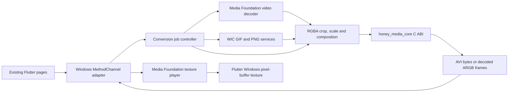

# Windows Media Adapter Design

## Goal

Integrate the existing Flutter Windows application with `honey_media_core` so
the current video, GIF, slideshow, scrolling-danmaku, cached-video preview, and
original-video preview flows work on Windows without changing their Dart
service contracts.

The Windows adapter uses operating-system media APIs for source decoding and
preview. Cinepak encoding and decoding plus AVI muxing and reading remain in
the framework-independent C++17 core.

## Scope

The Windows implementation must support the existing `ebadge/converter`
methods:

- `getVideoThumbnail`;
- `previewFrames`;
- `convertVideo`;
- `encodeScroll`;
- `encodeFrames`;
- `decodeCvid`;
- `cancelConvert`.

It must also support the existing `ebadge/player` methods:

- `create`;
- `play`;
- `pause`;
- `seekTo`;
- `position`;
- `dispose`.

This work reuses the current Flutter pages and BLE file-transfer path. It does
not implement Windows camera capture, live camera encoding, hotspot setup,
Wi-Fi video transport, or the `ebadge/encoder` channel.

## Constraints

- `honey_media_core` remains C++17 and exposes only the `hmc_` C ABI.
- The core must not depend on Flutter, Dart, Win32 UI, Media Foundation, WIC,
  COM smart pointers, or Windows-only types.
- The Windows adapter may depend on the Flutter Windows embedding, Media
  Foundation, WIC, COM, and ordinary Win32 synchronization primitives.
- No third-party native codec library is added.
- Existing Dart method names, argument maps, return maps, progress callbacks,
  and cancellation calls remain source-compatible with Android.
- Media conversion and decode work must not block the Flutter platform thread.
- A stale asynchronous task must never complete, emit progress, or overwrite
  state belonging to a newer task.

## Architecture

The adapter is a platform boundary, not a second codec implementation. It
owns source-file interpretation, frame scheduling, pixel-format conversion,
Flutter values, threading, progress, cancellation, and texture lifetime. The
core owns only the supported Cinepak/MSV1 bitstreams and AVI containers.

## Components

### Flutter channel registration

The existing Windows runner registers a project-owned plugin after generated
plugins. The plugin owns the `ebadge/converter` and `ebadge/player` channels.
It translates `EncodableValue` maps into typed adapter requests and maps
adapter failures to stable `FlutterError` codes.

Channel registration lives outside generated files. No edit is made to
`generated_plugin_registrant.cc` or `generated_plugins.cmake`.

### Conversion job controller

Only one converter job may be active at a time, matching the current Dart
facade's single progress callback. Starting a second job while one is active
returns `busy`; it does not cancel the first job implicitly.

Each job receives a monotonically increasing generation and an atomic cancel
flag. Worker results and `onProgress` callbacks are posted back to the Flutter
platform task runner and recheck the generation before delivery. Cancellation
returns the same cancelled outcome used by Android and cannot affect a later
job.

All COM interfaces and native buffers are held by RAII owners. The worker
initializes COM and Media Foundation for its own execution context. Destruction
waits for or safely detaches completed work without blocking the UI thread on
unbounded media processing.

### MP4 and MOV source decoding

Media Foundation `IMFSourceReader` opens local MP4/MOV files, selects the first
video stream, and requests uncompressed RGB32 output. The decoder records:

- coded width and height;
- effective display orientation;
- source duration;
- source frame timestamps;
- source frame rate when available.

The adapter normalizes signed stride and orientation into tightly packed,
top-down RGBA8888 before calling the transform or core. Conversion samples by
presentation timestamp at the requested output FPS, caps the result at
`maxFrames`, and never emits duplicate source frames for the same target time.

Unsupported containers, missing video streams, unavailable system codecs, and
corrupt samples return deterministic errors instead of partial AVI output.

### GIF decoding and composition

WIC opens GIF files and reads logical-canvas metadata, frame rectangles, frame
delays, transparency, and disposal mode. Frames are composited in presentation
order on a persistent RGBA canvas. Restore-to-background and
restore-to-previous disposal are applied before the next frame.

Zero or missing GIF delays use the same bounded fallback as Android. Conversion
samples the composed animation timeline at the requested FPS and composites
transparent pixels over the requested opaque `bgColor`. Thumbnail and preview
PNG output retain alpha so the existing Flutter preview can choose its own
background.

### RGBA transform

The transform consumes top-down RGBA8888 and produces tightly packed RGBA8888
whose width and height are positive multiples of four.

An explicit normalized crop rectangle takes precedence over `cropMode`.
Coordinates are clamped to the source bounds and rejected if their resulting
area is empty. Without an explicit crop:

- `cover` center-crops to the output aspect ratio;
- `contain` preserves the complete source and fills outside pixels with
  `bgColor`.

Scaling is bilinear and deterministic. Rotation is applied before crop
interpretation so the dimensions exposed to Dart match the upright image.

### Cinepak and AVI operations

Conversion creates one `hmc_cinepak_encoder_t` and one `hmc_avi_muxer_t` per
job. Each transformed frame is encoded in presentation order. The normalized
frame flags returned by the encoder are passed directly to the muxer. The
adapter does not inspect payload bytes to guess key frames.

`encodeFrames` accepts the Dart-provided RGBA frames and hold counts. Each
source slide starts with a forced key frame; repeated holds may use the core's
valid no-change inter-frame behavior. `encodeScroll` creates each scroll
viewport in the adapter and uses the same encoder/muxer path.

`decodeCvid` copies or reads the AVI through `hmc_avi_reader_t`, decodes frames
sequentially with one stateful `hmc_cinepak_decoder_t`, samples at most
`maxCount` frames, scales them to `maxEdge`, and encodes returned images as PNG
with WIC.

The adapter releases every `hmc_owned_buffer_t` with
`hmc_owned_buffer_release` and never lets a borrowed frame view outlive its
reader.

### Original-video texture player

The `ebadge/player` implementation uses Media Foundation for local MP4/MOV
decode. A player owns one Flutter pixel-buffer texture, one decoded BGRA frame,
a playback clock, and a generation token.

`create` returns only after the first renderable frame and reports texture ID,
upright width/height, and duration. `play` advances according to source
timestamps and loops at end-of-stream. `pause` freezes the clock. `seekTo`
flushes decoder state and publishes the first frame at or after the requested
position. `position` reports the clock position. `dispose` unregisters the
texture and invalidates pending decode callbacks.

Decoded storage remains owned by the player while Flutter's pixel-buffer
callback reads it. Frame publication uses a short mutex-protected swap and
`MarkTextureFrameAvailable`; Media Foundation decode does not run under that
mutex.

GIF preview continues using `previewFrames` and the existing Dart timer because
the current page intentionally controls GIF frame playback in Flutter.

## Channel compatibility

Successful responses preserve the maps expected by `ConverterService` and
`NativeVideoPlayer`:

- thumbnail: `bytes`, `width`, `height`, `isGif`;
- preview/decode: `frames`, `intervalMs`;
- conversion: `avi`, `width`, `height`, `frameCount`, `fps`;
- player create: `textureId`, `width`, `height`, `durationMs`.

Progress is delivered through `onProgress` with `done` and `total`. It is
monotonic, begins after total work is known, and is never delivered after the
job's terminal result.

Stable Windows error codes are:

- `invalid_argument`;
- `not_found`;
- `unsupported_media`;
- `decode_failed`;
- `encode_failed`;
- `io_error`;
- `busy`;
- `cancelled`;
- `invalid_state`.

Error messages include operation context but never expose native pointers or
unbounded system diagnostic text.

## Build integration

The Windows build adds `media_core` as a CMake subdirectory and links
`honey_media_core` into the project-owned media adapter target. The adapter
links the required Windows libraries, including Media Foundation, Media
Foundation Platform, Media Foundation Read/Write, Windows Codecs, and COM.

The runner links the adapter target and calls one registration function after
`RegisterPlugins`. This keeps project code out of Flutter-generated files and
allows the adapter to be unit-tested without launching the complete UI.

## Testing

Implementation follows red-green-refactor. Tests are split by boundary:

- pure C++ transform tests for crop, contain, cover, rotation, stride, and
  cancellation checkpoints;
- WIC GIF tests for delay, alpha, offsets, and disposal using a checked-in small
  fixture;
- Media Foundation tests using a checked-in short MP4/MOV fixture already
  present under `assets/example/video`;
- adapter/core integration tests that produce AVI, reopen it with
  `hmc_avi_reader_t`, and decode representative frames;
- channel contract tests for validation, response maps, busy behavior,
  cancellation generations, and stale completion suppression;
- texture-player state tests for create/play/pause/seek/loop/dispose;
- existing `honey_media_core` Debug and Release CTest suites;
- existing Flutter tests;
- Windows Release build and application smoke test.

The runtime smoke test selects a bundled MP4 and GIF, verifies thumbnail and
motion preview, converts both, decodes the resulting cached AVI preview, and
confirms the resulting resource can enter the existing BLE send flow. Actual
device receipt remains a hardware acceptance step when an eBadge is available.

## Acceptance criteria

The work is complete when:

1. Existing Android and Flutter tests remain green.
2. Windows native unit and integration tests pass in Debug and Release.
3. `flutter build windows --release` succeeds with no generated-file edits.
4. The Windows app can thumbnail, preview, convert, cancel, and cache-preview
   the bundled MP4/MOV and GIF samples.
5. Slideshow and scrolling-danmaku generation produce AVI files accepted by
   the core reader and decoder.
6. The built Windows executable links and exercises `honey_media_core`; the
   core is not merely compiled by a standalone test target.
7. No old Kotlin codec implementation or Android JNI layer is introduced into
   the Windows dependency path.
8. Camera projection, hotspot, and Wi-Fi video behavior remain unchanged and
   explicitly outside this delivery.
