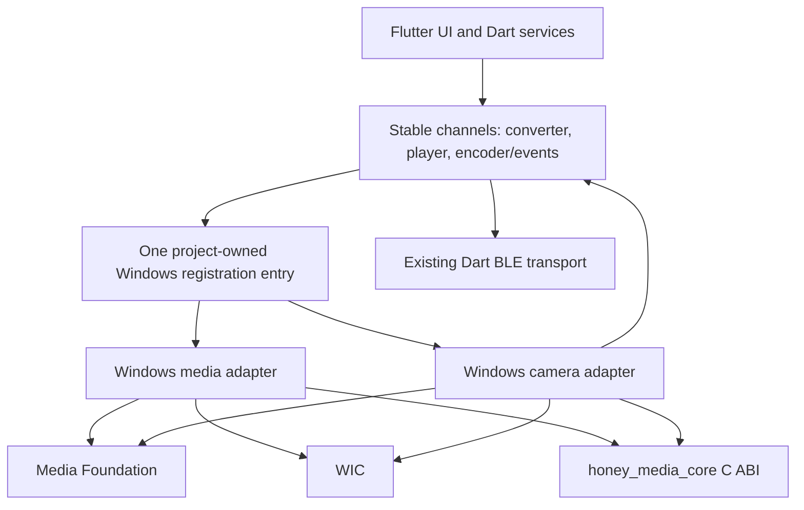

# HoneyBox Windows 媒体与摄像头功能对齐设计

## 1. 目标

在 Windows 10/11 x64 上对齐 HoneyBox Android 版的以下能力：

- 视频、GIF 的选择、缩略图、帧预览、原视频播放、转换、进度和取消；
- 多图轮播、滚动视频编码和 Cinepak/AVI 缓存解码；
- 内置及 USB 摄像头选择、实时预览、拍照、摄像头控制；
- H.264、JPEG、MSV1 三种摄像头编码和 BLE 投屏。

本设计优先保证平台隔离。Flutter 页面和 Dart 服务保留稳定业务契约；Windows
适配层负责 Windows 系统媒体接口；`honey_media_core` 继续只负责确定性的编解码
及 AVI 容器处理。未来新增平台时实现自己的平台适配层，而不是复制 Flutter 业务
或把平台 API 放入共享核心。

## 2. 与已有设计的关系

已有 `2026-08-01-windows-media-adapter-design.md` 继续作为里程碑 1 的详细媒体
规格，已有 `2026-08-01-windows-media-adapter-implementation.md` 继续作为里程碑 1
的实施计划基础。

已有媒体规格中的“摄像头不在范围内”只适用于里程碑 1。本规格在不改变里程碑 1
隔离边界的前提下，增加独立的里程碑 2 摄像头设计，并补充整套交付的顺序、性能门、
设备选择、能力降级及跨平台边界。若验收要求出现差异，以本规格中的分层一致、性能门
和分里程碑证据要求为准。

## 3. 范围

### 3.1 里程碑 1：媒体转换与播放

实现现有 `ebadge/converter` 方法：

- `getVideoThumbnail`；
- `previewFrames`；
- `convertVideo`；
- `encodeScroll`；
- `encodeFrames`；
- `decodeCvid`；
- `cancelConvert`。

实现现有 `ebadge/player` 方法：

- `create`；
- `play`；
- `pause`；
- `seekTo`；
- `position`；
- `dispose`。

### 3.2 里程碑 2：摄像头与 BLE 投屏

实现现有 `ebadge/encoder` 命令和 `ebadge/encoder/events` 事件，包括：

- 摄像头枚举、选择、打开、关闭和实时预览；
- 参数更新、缩放、能力允许时的对焦及曝光补偿；
- 拍照；
- H.264、JPEG、MSV1 编码；
- 开始、停止、关键帧请求、传输节拍和编码预览；
- 帧、统计、开始、停止、错误和信息事件；
- 继续使用现有 Dart BLE 传输和设备协议。

### 3.3 明确不包含

- Windows 本地热点、WiFi 配网及 WiFi 视频投屏；
- Windows 系统通知监听和通知转发；
- Windows 安装包、应用内更新和发布服务改造；
- Windows 7、Windows ARM64；
- FFmpeg、OpenCV、外部编解码包或要求用户另行安装的运行时；
- 与本次媒体、摄像头对齐无关的 Flutter 页面重构。

## 4. 已确认的产品决策

- 支持平台限定为 Windows 10/11 x64。
- 用户无需安装 FFmpeg、编解码包或其他第三方运行时。
- 摄像头采用设备列表语义，不模拟不可靠的 Windows“前/后摄像头”关系。
- 列出内置和 USB 摄像头，记住所选 `deviceId`；设备缺失或运行中拔出时停止
  当前会话并提示重新选择，不静默切换到另一摄像头。
- 摄像头控制采用能力驱动。支持的控制可用；不支持的控制禁用并说明原因；缩放可用
  统一 RGBA 变换中的软件裁剪回退。
- H.264、JPEG、MSV1 三种格式全部对齐。JPEG 和 MSV1 由应用自身保证；H.264
  使用系统 Media Foundation Encoder MFT，MFT 不可用时只禁用 H.264。
- 先完成并验收里程碑 1，再开始里程碑 2。

## 5. 跨平台架构



边界规则如下：

1. `honey_media_core` 保持 C/C++17 和 `hmc_` C ABI，不依赖 Flutter、Dart、
   Win32 UI、COM、Media Foundation、WIC、摄像头、文件系统或平台线程。
2. Windows 媒体适配层拥有源文件解释、系统解码、像素标准化、转换任务、播放器
   Texture 和媒体 channel。
3. Windows 摄像头适配层拥有设备枚举、能力、捕获、摄像头会话、编码会话和
   encoder channel；它不拥有 BLE 协议及传输状态。
4. Flutter bridge 只负责参数映射、平台线程投递、MethodChannel/EventChannel 和
   Texture 生命周期，不在平台线程执行解码或编码。
5. Runner 只调用一个项目自有注册函数。不得修改
   `generated_plugin_registrant.cc` 或 `generated_plugins.cmake`。
6. 转换任务和摄像头会话拥有独立 controller、generation、取消标志、队列和线程，
   不能互相取消、复用活动状态或提交对方的回调。

## 6. 组件与源码所有权

### 6.1 共享媒体核心

`media_core` 继续拥有：

- Cinepak 编码、解码；
- MSV1 编码、解码；
- AVI mux、reader；
- C ABI 缓冲区所有权和释放函数；
- 跨平台确定性 fixture 与 CTest。

核心只消费像素、字节和数值参数。系统解码后的色彩差异、摄像头设备、时间戳调度、
Flutter 值类型及错误展示均不进入核心。

### 6.2 Windows 媒体模块

里程碑 1 延续已有的 `windows/media` 两层目标：

- `honey_media_windows_core`：Media Foundation/WIC、RGBA 变换、`hmc_`
  pipeline、转换 controller 和播放器状态；不依赖 Flutter；
- `honey_media_windows_plugin`：converter/player channel、平台线程和 Texture。

### 6.3 Windows 摄像头模块

里程碑 2 新建独立 `windows/camera` 目标：

- `honey_camera_windows_core`：设备枚举、能力模型、Media Foundation 捕获、帧采样、
  摄像头状态机以及 H.264/JPEG/MSV1 编码会话；不依赖 Flutter；
- `honey_camera_windows_plugin`：encoder channel/events、摄像头及编码预览 Texture、
  平台线程事件投递。

仅将实际被两个模块共同使用、且不带业务状态的 COM RAII、像素帧结构、generation
工具放入最小 `windows/common`。不得为了假设中的未来平台把 Media Foundation/WIC
包装成伪跨平台核心。新增平台应实现同一 Dart 契约并复用 `honey_media_core`。

## 7. 里程碑 1 数据流

媒体转换的数据流是：

1. Dart 提交并完成参数校验；
2. Media Foundation 解码 MP4/MOV，或 WIC 解码/合成 GIF/PNG；
3. 适配层输出顶向下、紧密排列的 RGBA8888；
4. 确定性变换执行旋转、裁剪、缩放和背景合成；
5. `hmc_` 完成 Cinepak/AVI 编码，或 Cinepak/AVI 缓存解码；
6. 平台线程提交兼容的进度、结果或错误。

同一时刻只接受一个转换任务。活动任务存在时的新请求返回 `busy`，不会隐式取消旧
任务。每个被接受的任务获得单调 generation 和原子取消标志；取消、终止及下一任务
开始都会使旧 generation 无法再提交进度、结果或错误。

原视频播放器拥有独立 generation、播放时钟、Media Foundation decoder 和
PixelBufferTexture，不借用转换任务状态。`dispose` 后任何迟到帧都不能重新标记
Texture 可用。

## 8. 里程碑 2 摄像头设计

### 8.1 设备枚举与记忆

Windows 端在 `ebadge/encoder` 增加 `listCameras`，返回稳定列表项：

- `deviceId`：系统媒体设备标识；
- `name`：用户可读名称；
- `isDefault`：当前系统默认设备；
- `position`：`front`、`back`、`external` 或 `unknown`，仅作展示提示；
- 可用捕获分辨率和帧率摘要。

Dart 将所选 `deviceId` 与现有 encoder 配置分开持久化。`openCamera` 增加可选
`deviceId`；未提供时首次使用系统默认设备。已保存设备不存在时页面显示选择界面，
不得静默换用别的设备。Android 可忽略新增可选字段，现有 `facingFront` 语义保留。

### 8.2 能力模型

摄像头打开后的 `camera` 事件保留现有字段，并追加可选字段：

- `deviceId`、`displayName`；
- `supportedFormats`，取值来自 `h264`、`jpeg`、`mvs1`；
- `zoomMin`、`zoomMax`、`softwareZoom`；
- 已有 `focusSupported`、`evMin`、`evMax`、`evStep`。

不支持的控制不能导致摄像头主流程失败。焦点和曝光不支持时返回稳定的能力错误并由
UI 禁用；软件缩放始终作用于预览、拍照和编码前的同一标准帧，保证三条路径构图一致。

### 8.3 捕获和标准帧

Media Foundation Capture 使用选定 `deviceId`，从设备能力中选择能覆盖目标宽高和
fps 的最合适模式。系统样本统一转换为顶向下 RGBA8888，再执行方向、镜像、中心裁剪、
软件缩放及输出尺寸变换。

预览 Texture、拍照和三种编码器只消费这份标准帧语义。拍照使用最近一张完整标准帧并
通过 WIC 编码 JPEG，不依赖编码会话是否运行。

捕获回调只完成样本所有权转移和轻量入队，不能执行编码或 Flutter 回调。队列有界并
采用最新帧优先；处理能力不足时丢弃过期待处理帧，而不是无限增长内存或累积显示延迟。

### 8.4 三格式编码

- H.264：使用 Windows Media Foundation Encoder MFT，保持现有 bitrate、fps、
  I-frame interval、无 B 帧、关键帧请求及传输节拍语义。MFT 不存在时从
  `supportedFormats` 移除 `h264` 并返回 `codec_unavailable`，不影响 JPEG/MSV1。
- JPEG：使用 WIC 按现有 `jpegQuality` 编码，每帧都是关键帧。
- MSV1：标准 RGBA 帧转换为核心所需格式，使用 `honey_media_core` 保持关键帧、
  skip 和 `msv1SkipThr` 语义。相同标准输入和参数必须逐字节一致。

H.264 的 `requestEncoderFrame` 继续表示 BLE 传输完成后允许下一编码帧；JPEG/MSV1
按照目标 fps 从最新标准帧采样。BLE 背压时不积压捕获帧。`requestKeyframe` 对
H.264 请求 IDR，对 MSV1 请求新的完整帧，对 JPEG 是安全空操作。

编码预览保持 Android 行为：JPEG/MSV1 可执行 encode-decode-preview；H.264 不要求
编码回环预览。原始摄像头预览始终可用。

### 8.5 摄像头状态机和热插拔

状态机是：

```text
Idle -> Opening -> Previewing <-> Encoding -> Stopping -> Previewing
```

权限拒绝、设备拔出、系统媒体对象失效或编码器错误时按固定顺序处理：

1. 使摄像头 session generation 失效；
2. 停止接受捕获帧；
3. 清空待处理队列并停止编码提交；
4. 释放编码器、Source Reader、COM 对象和 Texture；
5. 只发送一次结构化终止错误；
6. 回到 `Idle`，要求用户重新选择或重开设备。

设备拔出时不得自动切换设备，也不得让旧设备的迟到回调污染下一会话。

## 9. Channel 兼容与错误模型

converter/player 的成功返回字段继续遵循已有媒体规格。encoder 保留现有命令、事件名
和字段；新增设备字段和能力字段全部是向后兼容的可选扩展。

MethodChannel 失败使用以下稳定代码：

- `invalid_argument`；
- `not_found`；
- `unsupported_media`；
- `permission_denied`；
- `device_unavailable`；
- `device_lost`；
- `codec_unavailable`；
- `decode_failed`；
- `encode_failed`；
- `io_error`；
- `busy`；
- `cancelled`；
- `invalid_state`。

EventChannel 的 `error` 事件追加 `code` 和可选 `details`，同时保留 `message`，使现有
页面仍能显示文本。HRESULT、MFT 名称和系统诊断文本只作为有界的 `details`，Dart
业务逻辑不得依赖它们。

## 10. 线程、取消和内存所有权

- Flutter 平台线程只注册 channel、完成 result、发送 event 及标记 Texture 帧；
  不执行媒体 IO、解码、变换或编码。
- 转换 controller 拥有单一转换 worker；转换和播放器状态相互独立。
- 摄像头捕获、编码和 Flutter 事件投递分离；BLE 发送慢不能阻塞捕获回调。
- generation 必须在每个异步提交点检查。终止后的回调可以完成内部清理，但不能触发
  Dart 或 Texture 状态变化。
- COM 接口、Media Foundation 对象和 Texture 使用 RAII。
- `hmc_owned_buffer_t` 只用 `hmc_owned_buffer_release` 释放，borrowed view 不得超过
  reader/decoder 生命周期。
- Texture pixel buffer 在 Flutter 读取期间由 player 或 camera session 持有，发布
  只做短时锁保护的指针/所有权交换，不在该锁内解码或编码。

## 11. 构建与部署

- Windows CMake 分别链接 media、camera、Flutter bridge 和 `honey_media_core`。
- 链接 Windows 自带 Media Foundation、Media Foundation Platform、Read/Write、WIC、
  COM 等系统库。
- Release 产物不得要求用户安装 FFmpeg、外部 codec pack 或单独运行时。
- Windows native tests 同时构建 Debug 和 Release。
- Runner 通过项目自有头文件调用单一注册入口，Flutter 生成文件保持未修改。

## 12. 分层一致标准

一致性分为两层：

1. 确定性核心层：同一 RGBA 帧序列和参数进入 `honey_media_core` 后，Cinepak、MSV1
   和 AVI 结果与 Android 使用同一核心的结果逐字节一致。
2. 系统媒体端到端层：由于 Android 系统 decoder 与 Windows Media Foundation/WIC
   可能产生少量像素差异，MP4/MOV/GIF 按画面容差、帧数、时长、方向、裁剪、设备
   播放效果一致验收，不要求最终 AVI 逐字节相同。

## 13. 测试设计

### 13.1 里程碑 1 自动化

- `honey_media_core` Debug/Release CTest 和现有跨平台 fixtures；
- RGBA crop/contain/cover/rotation/stride/background golden tests；
- WIC GIF delay、alpha、offset、disposal 和 restore-previous tests；
- Media Foundation MP4/MOV 帧数、时间戳、方向和像素容差 tests；
- converter/core 生成、重开及解码集成测试；
- channel 参数、返回 map、busy、cancel、generation、迟到完成测试；
- player create/play/pause/seek/loop/dispose 和 Texture 生命周期测试；
- 现有 Flutter 全量测试及 Windows Release build。

### 13.2 里程碑 1 运行与设备验收

- 使用真实 MP4、MOV、GIF 和仓库示例资源完成选择、缩略图、预览、转换和取消；
- 完成视频、轮播和缓存预览页面流程；
- 将生成 AVI 通过现有 BLE 路径发送到目标设备并确认播放、时长、方向和色彩。

### 13.3 里程碑 2 无硬件自动化

- 使用 fake camera backend 测试枚举、deviceId、能力模型和模式选择；
- 测试 Idle/Opening/Previewing/Encoding/Stopping 状态及非法转换；
- 测试权限拒绝、热拔出、旧 generation、重复关闭和错误只发送一次；
- 测试有界队列、目标 fps 采样和丢弃旧帧；
- MSV1 fixture 逐字节一致、JPEG 解码容差、H.264 NAL/关键帧合同；
- encoder channel 命令、事件、可选字段和 Android 兼容性测试。

### 13.4 里程碑 2 Windows 与目标设备验收

- 至少一个内置摄像头和一个 USB 摄像头；
- deviceId 记忆、设备缺失提示、运行中拔出和重新打开；
- Windows 摄像头隐私拒绝及恢复；
- 能力驱动的焦点、曝光、软件缩放和不支持控制的 UI；
- 在至少一台具备 H.264 Encoder MFT 的参考机上完成 H.264 验收；
- 通过不具备 H.264 MFT 的环境或可控测试 backend 验证只禁用 H.264；
- JPEG、MSV1、H.264 三格式 BLE 投屏；
- 关键帧请求、拍照、原始预览、JPEG/MSV1 编码预览、统计和停止结果；
- 目标设备上的分辨率、fps、方向、镜像、色彩和恢复能力。

## 14. 性能与稳定性门

验收记录必须注明参考机 CPU、内存、Windows 版本和摄像头型号。

- 360x360、10 fps 摄像头连续运行 30 分钟，队列和内存不得持续增长；
- 在 BLE 不是瓶颈时，JPEG、MSV1、H.264 在参考机上维持 360x360、10 fps；
  BLE 背压出现后允许有效发送帧率下降，但只允许丢弃旧帧，不允许持续累积延迟；
- 以 360x360、10 fps 和页面默认质量参数执行离线媒体转换，至少达到实时速度，
  10 秒源视频在参考机上不超过约 10 秒；
- 取消请求在 1 秒内到达终态；
- 页面关闭、取消或摄像头拔出后不得继续出现旧进度、旧事件或旧 Texture 帧。

## 15. 里程碑验收门

### 15.1 里程碑 1 完成条件

1. 媒体 native tests 在 Debug/Release 通过；
2. 现有 Flutter 和 Android 测试保持通过；
3. Windows Release 构建成功且无生成文件修改；
4. converter/player 所有方法在 Windows 实际运行；
5. 分层一致和实时转换门通过；
6. 至少一次目标设备 AVI 播放验收通过；
7. 自动化、Windows 运行和设备证据分别记录。

里程碑 1 未通过时不得开始里程碑 2 生产实现。

### 15.2 里程碑 2 完成条件

1. camera native/channel tests 在 Debug/Release 通过；
2. 内置和 USB 摄像头选择、记忆、拔出和恢复通过；
3. 三种格式的 Windows 编码及目标设备 BLE 投屏通过；
4. 能力降级不会使摄像头主流程不可用；
5. 30 分钟稳定性、取消和旧事件隔离门通过；
6. Android 摄像头和 BLE 投屏行为没有回归；
7. 自动化、Windows 运行和设备证据分别记录。

## 16. 后续平台迁移规则

新增平台时复用两项稳定资产：

- Dart channel/事件合同；
- `honey_media_core` C ABI 和确定性 fixtures。

新增平台自行实现源媒体解码、播放器 Texture、摄像头枚举/捕获和系统 H.264/JPEG
能力。不得把某个平台的设备模型、系统句柄或线程模型提升到 `honey_media_core`。
只有第二个平台实际出现相同实现后，才从平台适配层提取新的可移植辅助模块。

## 17. 实施计划边界

本规格确认后分两份计划执行：

1. 先复核并更新已有 Windows media adapter 计划，使其包含本规格新增的分层一致、
   性能和设备证据要求，然后实施里程碑 1；
2. 里程碑 1 验收完成后，为 `windows/camera` 编写独立详细计划并实施里程碑 2。

任何编译成功只能证明对应构建步骤通过，不能替代 Windows 运行、性能或目标设备验收。
