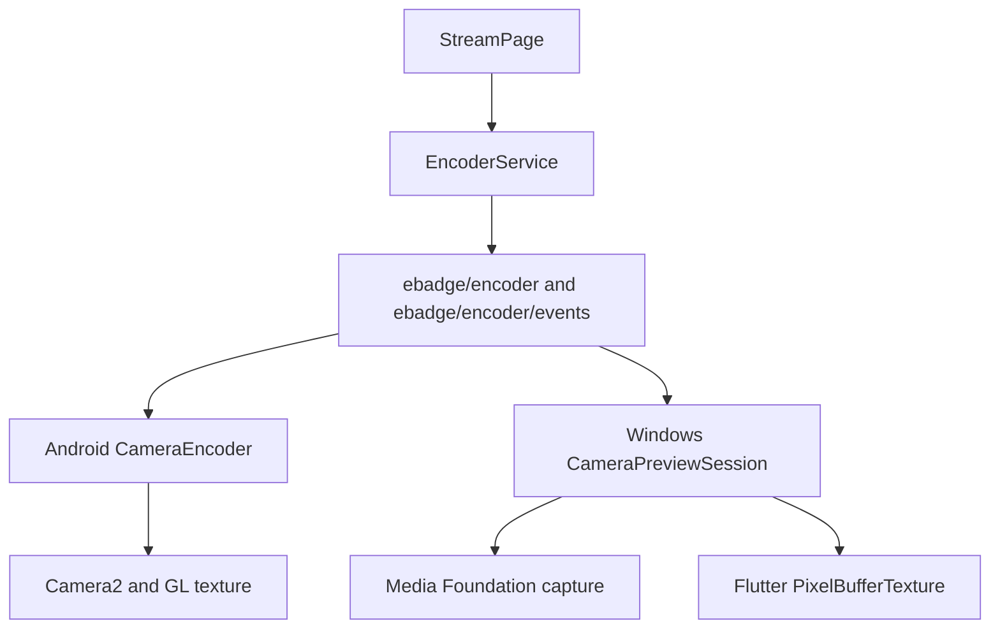

# HoneyBox Windows 摄像头预览增量设计

## 1. 目标

在 Windows 10/11 x64 上恢复 HoneyBox 投屏页面的内嵌实时摄像头预览，消除
“正在启动摄像头”永久等待。Windows 与 Android 继续使用同一套 Dart 服务、平台
通道和事件合同；两个平台只在原生摄像头 API 和帧处理实现上不同。

本设计把既有
`2026-08-01-windows-media-camera-parity-program-design.md` 的摄像头里程碑拆成：

- 里程碑 2A：本设计中的摄像头预览；
- 里程碑 2B：后续继续实现拍照、控制、编码和投屏。

既有完整设计的跨平台边界、设备能力模型和后续编码方向保持有效；本设计只收窄当前
交付范围和验收门，不把临时预览实现作为另一套架构。

## 2. 已确认范围

本轮包含：

- 打开 Windows 默认可用摄像头；
- 在现有 Flutter 投屏页面中显示实时画面；
- 页面退出、应用生命周期变化及重新进入时正确关闭和重新打开摄像头；
- 摄像头缺失、被占用、权限拒绝或初始化失败时显示明确错误；
- 保持 Android 现有摄像头、编码和投屏行为不变；
- 为后续 Windows 编码提供可复用的标准帧源。

本轮不包含：

- 拍照；
- H.264、JPEG 或 MSV1 摄像头编码；
- BLE/WiFi 摄像头投屏；
- 焦点、曝光、缩放、前后摄像头或设备选择功能；
- 调整快门、设置及其他尚未实现功能的交互。

未在本轮实现的方法保持未支持状态，后续里程碑 2B 在相同 channel 中补齐。本轮不
通过重新引入 `camera` / `camera_windows` 建立第二套 Flutter 摄像头路径，也不调用
Windows 系统相机应用。

## 3. 架构



Flutter 保持一个 `EncoderService`，不根据平台选择不同业务服务。Windows 在现有项目
自有插件注册入口内增加 encoder 方法通道和事件通道；不修改 Flutter 生成的插件注册
文件。

Windows 摄像头代码采用与现有媒体适配层相同的两层边界：

- 无 Flutter 依赖的摄像头核心负责 Media Foundation 设备打开、采集线程、标准帧、
  状态和关闭；
- Flutter bridge 负责方法参数、事件投递和 Texture 生命周期，不在平台线程采集或
  转换画面。

摄像头状态、线程、generation 和缓冲区不与 converter/player 任务共享。可复用的
Texture 接口继续保持通用且无摄像头业务状态，播放器和摄像头分别拥有自己的纹理。

## 4. Android 合同一致性

Windows 必须复用现有名称和异步顺序：

1. Dart 先监听 `ebadge/encoder/events`；
2. Dart 调用 `ebadge/encoder.openCamera`；
3. 原生层接受请求后完成 MethodChannel 调用；
4. 摄像头和 Texture 准备完成后发送 `camera` 事件；
5. Dart 收到事件后设置 `CameraInfo`，现有 `Texture` 组件开始显示；
6. 失败通过 `error` 事件报告；
7. `closeCamera` 幂等停止会话并释放 Texture。

`camera` 事件本轮沿用现有字段：

- `textureId`；
- `previewWidth`、`previewHeight`；
- `sensorOrientation`，Windows 本轮为 `0`；
- `facingFront`，默认摄像头本轮为 `false`；
- `evMin`、`evMax`、`evStep`，本轮均为 `0`；
- `focusSupported`，本轮为 `false`。

Windows 不伪造尚未实现的焦点、曝光或前后摄像头能力。后续可通过可选字段扩展设备
信息，现有 Android 和 Dart 消费者不受影响。

## 5. Windows 采集与预览数据流

1. Media Foundation 使用视频采集设备源枚举默认可用设备；
2. 打开设备并选择能够覆盖请求尺寸和帧率的稳定捕获模式；
3. Source Reader 在专用 worker 上读取样本，并输出可转换的 RGB32/BGRA 帧；
4. 使用现有确定性 RGBA 变换完成方向、居中裁剪和缩放，生成配置要求的预览尺寸；
5. 将最新完整 BGRA 帧原子发布给 PixelBufferTexture；
6. 在 Flutter 平台线程标记 Texture 新帧可用；
7. 仅保留最新完整帧，不建立无界队列，不因 Flutter 绘制变慢累积延迟。

标准帧采用顶向下、紧密排列的 RGBA/BGRA 所有权对象。预览 Texture 读取期间由共享
快照持有内存；采集 worker 不修改已发布缓冲区。该标准帧边界将在里程碑 2B 被拍照和
编码会话复用。

## 6. 生命周期和并发

预览状态机为：

```text
Idle -> Opening -> Previewing -> Closing -> Idle
```

- 每次打开生成新的单调 generation；
- 新的 `openCamera` 先使旧 generation 失效并有序关闭旧会话；
- 采集回调、Texture 标记和事件投递前都检查 generation；
- `closeCamera` 可在任何状态重复调用；
- 关闭顺序是停止接受样本、停止并 join worker、释放 Source Reader/Media Source、
  注销 Texture、回到 `Idle`；
- 关闭完成后旧帧和旧错误不得送达 Dart；
- Flutter plugin 析构前必须完成相同关闭过程。

Media Foundation 和 COM 对象使用 RAII。Flutter 平台线程不等待设备读取；只有关闭
过程允许有界等待 worker 正常退出。若系统设备调用失败，会话进入关闭路径并只报告
一次终止错误。

## 7. 错误处理和页面终态

Windows 错误映射到稳定代码：

- `not_found`：没有摄像头；
- `permission_denied`：Windows 隐私权限阻止访问；
- `device_unavailable`：设备被占用或无法打开；
- `device_lost`：采集中设备失效；
- `invalid_state`：会话状态错误；
- `io_error`：无法归入以上类别的系统采集错误。

事件保留现有 `event: error` 和 `message`，并追加可选 `code`、`details`。HRESULT 只
进入有界诊断详情，Flutter 业务不依赖具体 HRESULT。

Dart 的 `_bootstrapCamera` 必须捕获 MethodChannel/初始化异常并进入 `_error` 状态；
预览区域在 `_error != null` 时显示错误和重试入口，只有尚无成功或失败结果时显示
“正在启动摄像头”。这保证平台通道意外缺失时也不会永久转圈。

## 8. 测试策略

生产代码之前先加入会失败的测试，并逐项完成 Red-Green-Refactor。

无硬件自动化包括：

- fake camera backend 的 `Idle/Opening/Previewing/Closing` 转换；
- 重复关闭、新打开淘汰旧 generation、关闭后迟到帧被丢弃；
- 最新帧覆盖和缓冲区生命周期；
- encoder channel 的 `openCamera`、`closeCamera` 参数及返回合同；
- `camera`、`error` 事件字段与 Android Dart 消费合同一致；
- Flutter 页面在打开异常时离开 loading 状态并显示错误；
- Windows Runner 仍只使用项目自有注册入口；
- 现有 converter、player、Texture 和 Android/Flutter 回归测试保持通过。

Windows 硬件验收使用本机 `FHD Camera`：

1. Release 应用进入投屏页面后显示连续实时画面；
2. 画面尺寸和方向正确，不持续增长内存；
3. 返回上一页后摄像头释放，Windows 设置或相机应用能够重新打开设备；
4. 再次进入投屏页面能够重新预览；
5. 摄像头被其他应用占用时显示错误而不是永久转圈；
6. 释放占用后通过重试恢复预览。

## 9. 完成条件

本轮仅在以下证据全部具备时完成：

1. 新增 camera core/channel/page 测试在 Debug 和 Release 通过；
2. 现有 Windows media tests、Flutter tests 和 Android 相关测试无回归；
3. Windows Release 构建成功且 Flutter 生成文件未被手工修改；
4. 在本机 `FHD Camera` 上完成打开、实时预览、退出释放和再次打开；
5. 失败路径显示明确错误，不再停留在无限 loading；
6. 提交中不包含工作树内无关文件。

编译或无硬件测试通过不能替代真实摄像头验收；真实摄像头画面可见也不能替代自动化
的关闭、迟到回调和错误终态测试。
