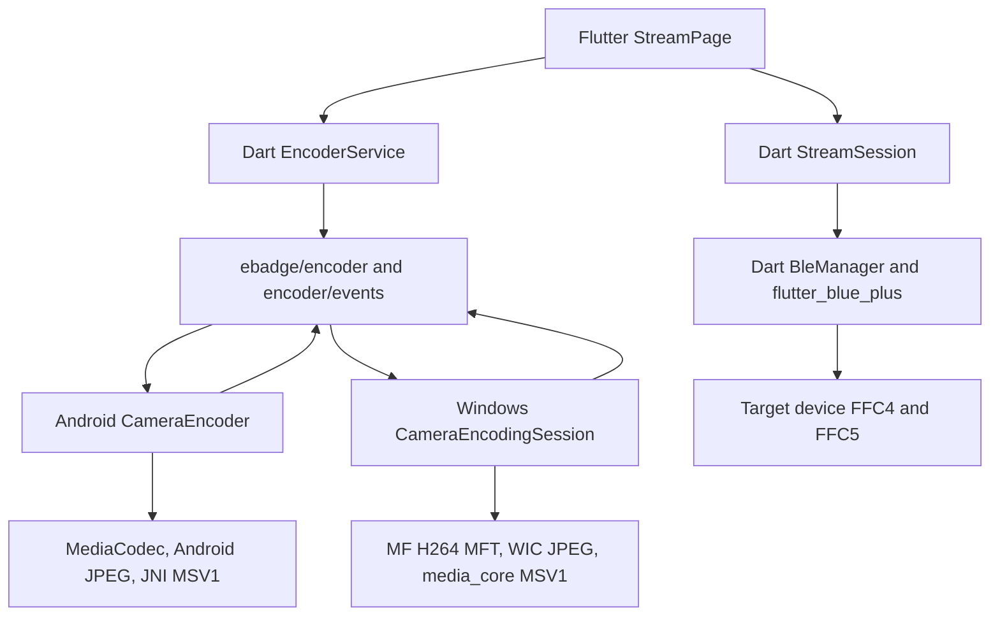

# HoneyBox Windows BLE 摄像头投屏设计

## 1. 目标

在 Windows 10/11 x64 上复用 HoneyBox 已经在 Android 与目标设备跑通的投屏框架，
接通 Windows 摄像头的 H.264、JPEG、MSV1 实时编码，并通过现有 FFC4/FFC5 BLE
Stream Service 投送到目标设备。

本设计是既有摄像头里程碑 2B 的实时编码与 BLE 投屏增量。已完成的 Windows 摄像头
原画预览继续作为标准帧源；本轮不建立 Windows 专属 BLE 协议，也不复制 Android 的
Flutter 业务逻辑。

实施和验收顺序固定为：

1. H.264；
2. JPEG；
3. MSV1。

当前目标设备已经验证支持 Android H.264 投屏，因此 H.264 是本轮必须通过的 Windows
真机完成门。设备是否支持 JPEG 和 MSV1 尚未确认；这两种格式必须完成 Windows 编码
及协议自动化，目标设备明确拒绝 `KS_OPEN` 时记录为设备能力限制。

## 2. 与既有设计的关系

本设计继承以下规格中已经确认的边界和产品决策：

- `2026-08-01-windows-media-camera-parity-program-design.md`：Windows 媒体与摄像头
  对齐的总体架构、三格式方向和里程碑 2 完成门；
- `2026-08-03-windows-camera-preview-design.md`：同一 `ebadge/encoder` 合同、Media
  Foundation 标准帧、Texture 生命周期和 generation 安全；
- `2026-08-03-windows-camera-preview-implementation.md`：已经落地的 Windows 默认
  摄像头预览和错误/重试行为。

本设计只扩展实时编码与 BLE 投屏，不推翻已完成的预览架构。若旧文档仍把编码或传输
列为预览切片范围外，以本设计对里程碑 2B 的新增范围为准。

## 3. 已验证基线

### 3.1 Android 参考实现

Android 与目标设备已经跑通，作为本轮默认参考条件。实际源码链路为：

1. `StreamPage` 先创建 `StreamSession` 并等待 `KS_OPEN`/`KS_ACK`；
2. 握手成功后调用 `EncoderService.startEncoding(stream: true)`；
3. Android `CameraEncoder` 从 Camera2 的单一 OES Texture 同时派生原画预览和编码
   输入，保证两条路径具有相同裁剪、缩放、方向和镜像；
4. 原生编码器只通过 `ebadge/encoder/events` 产生 `frame` 事件；
5. Dart 发送泵、`StreamSession`、`BleManager` 负责队列、分片、信用、重传以及
   FFC4/FFC5 GATT 收发。

Android H.264 的参考语义是 Constrained Baseline、CBR、无 B 帧、目标 fps 节流、
两个初始 permit、每发送完一帧补一个 permit，并在每个投屏 IDR 前置 SPS/PPS。
JPEG 每帧都是关键帧；MSV1 保持 previous-frame、skip、阈值和周期关键帧语义。

### 3.2 Windows 当前状态

Windows 已经具备：

- Media Foundation 摄像头采集和正确颜色的 RGBA 原画预览；
- `ebadge/encoder` 与 `ebadge/encoder/events` 注册；
- `openCamera`、`closeCamera` 和 `camera`/`error` 事件；
- `flutter_blue_plus_winrt`、FFC1/FFC2 文件/命令通道、FFC4/FFC5 Stream Service；
- Dart `StreamTransport`、`StreamSession`、发送队列、信用和 gap 重传；
- `honey_media_core` 的 MSV1 编码能力以及 Windows WIC/Media Foundation 基础设施。

当前阻塞点是 Windows encoder channel 对 `startEncoding` 等命令返回
`NotImplemented`，也不会产生 `frame` 事件。BLE 协议层不是本轮需要重新实现的缺口。

## 4. 范围

### 4.1 本轮包含

- 加固共享 Dart BLE 写队列、投屏 session 和发送泵的取消、断线及 generation 语义；
- Windows 原生编码 controller/session 和有界最新帧输入；
- Windows H.264 Encoder MFT 后端；
- Windows WIC JPEG 后端；
- 直接复用 `honey_media_core` 的 Windows MSV1 后端；
- `startEncoding`、`stopEncoding`、`requestKeyframe`、
  `requestEncoderFrame`；
- `started`、`frame`、`stats`、`stopped`、`error` 和必要的 `info` 事件；
- Windows 本地编码能力与设备 `KS_OPEN` 拒绝的可区分错误；
- Windows、Flutter、共享 Dart 和 Android 回归测试；
- H.264 Windows 到目标设备的真实 BLE 出画面与稳定性验收；
- JPEG/MSV1 在设备支持时的条件真机验收。

### 4.2 本轮不包含

- Windows WiFi 投屏、本地热点或 WiFi 配网改造；
- 新的 Windows 原生 BLE 协议或 GATT 实现；
- FFmpeg、OpenCV、外部 codec pack 或要求用户安装的新运行时；
- 摄像头设备选择、对焦、曝光、拍照和编码预览等其它里程碑 2B 功能；
- 投屏同时录制到本地文件；本轮 `recordToFile=true` 必须返回明确的 `unsupported_feature`，不能静默忽略；
- 为了本轮投屏重写已经跑通的 Android Camera2/GL/MediaCodec 生产实现；
- 把 Media Foundation、WIC 或 Camera2 放入共享媒体核心；
- 在没有协议定义依据时把任意 `KS_ACK` 非零结果猜成具体设备错误码。

## 5. 跨平台复用边界



复用规则：

1. 页面、Dart 服务、协议字节、BLE 状态机和发送策略跨平台复用；
2. 通道名、方法、参数和事件 map 是稳定平台合同；
3. Android 与 Windows 分别实现同一平台 adapter 合同；
4. MSV1 的确定性算法通过 `honey_media_core` 复用；
5. Camera2、MediaCodec、Media Foundation、WIC 和平台 Texture 留在各自适配层；
6. Windows 不直接拥有 BLE session，也不从原生编码 worker 调用 GATT；
7. 未来 iOS 或 SDK 化时实现同一 adapter 合同，不复制 Flutter 业务状态机。

Android 当前没有独立的通用 `EncoderBackend` 接口，而是在 `CameraEncoder` 内根据格式
分派。Windows 可以在不改变 wire 的前提下把三种 codec 后端显式接口化，以便独立
测试和后续平台复用；这属于内部结构改进，不要求先重构 Android。

## 6. Windows 组件

### 6.1 标准帧发布

已完成的 Media Foundation 摄像头继续输出顶向下、紧密排列的 RGBA8888
`CameraFrame`。同一份经过方向、裁剪、缩放后的不可变共享帧同时提供给：

- `CameraTextureController`：发布 Flutter 原画预览；
- `CameraEncodingSession`：按目标 fps 和背压策略提交给当前 codec 后端。

两个消费者持有独立共享快照。捕获 worker 不修改已发布内存，不在捕获回调中执行编码
或 Flutter 事件发送。

### 6.2 CameraEncodingSession

`CameraEncodingSession` 是无 Flutter 依赖的 Windows 编码协调器，拥有：

- 单调 encoding generation；
- `Idle/Starting/Encoding/Stopping` 状态；
- 当前配置和 codec backend；
- 一个有界的最新帧槽；
- 编码 worker、停止信号和统计；
- H.264 permit 计数；
- 帧、统计、停止和错误回调。

它不拥有摄像头设备、Texture、BLE session 或 Flutter sink。编码能力不足时只停止当前
编码会话，原画预览继续运行。

### 6.3 Codec backend 合同

三个后端实现统一的内部职责：

- 根据规范化配置启动；
- 接收不可变 RGBA 帧及时间戳；
- 输出编码字节、时间戳和 key 标记；
- 请求关键帧；
- 有序停止、排空并释放资源；
- 返回稳定的能力、配置或运行错误。

后端不发送 Flutter 事件，也不知道 BLE 信用。H.264 的 permit 在协调器提交编码前生效；
JPEG/MSV1 使用最新帧采样和页面已有的发送队列恢复策略。

## 7. 数据流和状态机

### 7.1 启动顺序

```text
Camera preview ready
  -> StreamSession.open(codec, width, height, fps)
  -> FFC4 KS_OPEN
  -> FFC5 KS_ACK success
  -> EncoderService.startEncoding(stream: true)
  -> Windows CameraEncodingSession starts backend
  -> started event
  -> frame events
  -> Dart send pump
  -> StreamSession.sendFrame
  -> FFC4 KS_FRAME
```

必须先获得设备 `KS_ACK`，再启动原生编码，避免第一个关键帧在 BLE session 未打开时
丢失。

### 7.2 编码状态机

```text
Previewing
  -> startEncoding -> Starting
  -> backend ready -> Encoding
  -> stop, disconnect, page exit, camera error -> Stopping
  -> backend drained and released -> Previewing
```

启动失败从 `Starting` 返回 `Previewing` 并发送一次 `error`。停止时先使 encoding
generation 失效、停止接受新帧、唤醒等待、清空最新帧槽，再排空/释放后端并发送一次
`stopped`。旧 generation 的帧、统计、停止或错误不得送达新会话。

摄像头关闭先使 camera generation 失效，再停止编码、停止捕获、释放编码器、Source
Reader 和 Texture。应用退出不得依赖 Flutter 继续消费事件才能完成清理。

### 7.3 背压

- H.264 投屏启动时有两个初始 permit；每提交一帧消耗一个；Dart 在完整编码帧发送成功
  或失败后调用 `requestEncoderFrame` 补一个；
- 没有 permit 时丢弃编码前的旧摄像头帧，不提交新的 H.264 输入；
- 已经编码的 H.264 P 帧不因页面队列积压而主动丢弃；
- JPEG/MSV1 按目标 fps 从最新标准帧采样；发送队列达到既有上限时清空旧积压并请求
  恢复关键帧；
- 所有模式都禁止捕获帧或编码任务形成无界队列。

## 8. 共享 Dart 传输加固

这些修改只强化异常和并发边界，不改变 FFC4/FFC5 协议字节和 Android 正常路径。

### 8.1 GATT 串行写队列

把当前分离的 `(characteristic, bytes)` 队列和以 `Uint8List` 为键的 completer map
收敛为显式写队列项。每项记录：

- characteristic；
- bytes；
- connection generation；
- 是否使用 write-without-response；
- 可选 completion。

FFC1 和 FFC4 继续共用同一串行队列。断线、写失败、dispose 或连接替换时，所有待完成
Stream Future 必须以错误结束，不能直接丢弃。旧 generation 的成功/失败回调不得继续
flush 新队列，也不得断开新连接。

若 characteristic 只支持带响应写，按实际属性选择写模式；现有同时支持
write-without-response 的目标设备行为不变。

### 8.2 Stream Service 初始化

命令/文件通道和实时流通道分别判断能力。缺少 FFC1/FFC2 不应阻止已发现的 FFC4/FFC5
完成通知订阅；每个通道只对自己的缺失能力报告不可用。实际 chunk 大小继续使用
协商得到的 MTU/PDU，而不是硬编码 512。

### 8.3 StreamSession generation

每次 open、close 和 disconnect 都递增 operation generation。重复 open 必须先完成旧
open Future；close/disconnect 必须完成 open/credit 等待并使旧发送、信用和重传任务
退出。

`sendFrame` 必须观察本帧所有已排队分片的完成结果，任一写失败则返回 false；不得只
等待最后一个 Future。信用窗口、序列号、三帧重传缓存和 REPORT gap 语义保持不变。

### 8.4 通知校验

FFC5 输入在读取字段前验证：

- 实际缓冲区至少包含声明的 value 长度；
- ACK 的实际 value 长度满足 sid/result/可选 credits；
- sid 必须等于当前 session；
- CREDIT 和 REPORT 的实际长度、gap count 与乘法边界有效；
- 畸形或旧 session 通知只丢弃，不修改状态、信用或重传缓存。

### 8.5 页面发送泵

每次投屏拥有 projection generation。发送泵、编码帧回调、transport availability
回调及异步 send 返回后都重新检查 generation。停止后旧 pump 即使从 await 返回，也
不能读取新会话队列或补充新编码器 permit。

`StreamTransport` 增加通用的可用状态变化接口。BLE 断开时页面调用
`StreamSession.onDisconnect()`、停止原生编码、清理发送队列并退出“投屏中”。未来
WiFi transport 可以复用相同生命周期接口。

## 9. H.264 后端

H.264 是首个纵向切片和必须真机验收的默认格式。

### 9.1 能力和配置

Windows 使用系统 Media Foundation H.264 Encoder MFT，不引入外部编码器。启动前探测
符合输入、输出和关键参数要求的 MFT。不存在可用 MFT 时返回 `codec_unavailable`，
原画预览继续运行，JPEG/MSV1 不受影响。

配置与 Android 对齐：

- 输出尺寸使用现有 wire width/height；
- fps、bitrate、I-frame interval 使用现有字段；
- H.264 Baseline/Constrained Baseline 能力允许时优先保持 Constrained Baseline；
- CBR；
- 无 B 帧、低延迟；
- 单调时间戳；
- 输入色彩转换留在 Windows H.264 backend，标准帧合同仍是 RGBA8888。

MFT 不接受必要配置时明确失败，不静默换成会破坏设备解码或 BLE 节拍的 profile、B 帧
或无界 VBR 行为。

### 9.2 输出规范化

EventChannel 的 H.264 `frame.data` 必须是 Annex-B。后端负责：

- 将系统输出的长度前缀 NAL 规范化为 start-code NAL，若输出已经是 Annex-B 则不重复
  包装；
- 从序列头或输出样本中缓存 SPS/PPS；
- 使用样本关键帧属性和 NAL 类型交叉验证 IDR；
- 每个流式 IDR 都带 SPS/PPS，已有时不重复附加；
- codec-config-only 输出只更新缓存，不单独作为普通 frame 事件发送。

`requestKeyframe` 请求下一次输出 IDR。MFT 不支持动态请求时返回稳定能力错误或采用有界
重启策略，不能假装请求成功。

### 9.3 停止

正常 stop 停止新输入、向 MFT drain、收集已接受输入对应的剩余输出、释放 MFT，再发送
一次 `stopped`。camera error、device lost 或强制关闭可走 abandon 路径，立即使
generation 失效，不再提交迟到输出。

## 10. JPEG 和 MSV1 后端

### 10.1 JPEG

- 使用 WIC 编码；
- 输出尺寸规范化为偶数；
- 使用现有 `jpegQuality`；
- 每帧都是 key；
- `requestKeyframe` 是成功的安全空操作；
- 编码失败只终止当前 encoding session，不关闭原画预览。

### 10.2 MSV1

- 直接调用 `honey_media_core`，不经 Flutter 或额外语言桥；
- 宽高按现有合同进行四像素对齐；
- previous RGBA 只在编码成功后更新；
- 保持 `msv1Skip`、`msv1SkipThr`、周期关键帧和显式关键帧；
- 失败的编码不得消耗显式关键帧请求或污染 previous-frame 状态；
- 与共享 fixture 相同输入及参数必须产生确定性结果。

JPEG/MSV1 本地实现和自动化是必需项。目标设备 `KS_OPEN` 非零拒绝时，页面显示带格式
名称的“设备拒绝该编码格式”，并把真机验收记录为条件未满足，而不是 Windows 编码
失败。除非设备协议另有明确结果码，不进一步猜测拒绝原因。

## 11. Channel 和事件合同

Windows 保持 Android 现有通道：

- MethodChannel：`ebadge/encoder`；
- EventChannel：`ebadge/encoder/events`。

本轮实现的方法：

- `startEncoding`；
- `stopEncoding`；
- `requestKeyframe`；
- `requestEncoderFrame`。

既有 `openCamera` 和 `closeCamera` 不改变。参数继续由 `EncoderConfig.toWire()` 提供。

事件字段保持：

```text
started: {event, path, width, height}
frame:   {event, data, key}
stats:   {event, frames, keyframes, bytes, keyBytes, fps, lastBytes}
stopped: {event, path, frames, keyframes, bytes}
error:   {event, message, optional code, optional details}
info:    {event, message}
```

本轮不实现投屏同时录制到本地文件：正常 BLE 投屏时 `path` 保持空字符串或 `null`，
与 Android 当前事件消费兼容；若调用方传入 `recordToFile=true`，Windows 必须返回
`unsupported_feature`，不能静默忽略该参数。事件只在平台 dispatcher 和有效
EventChannel sink generation 上发送；编码 worker 不直接调用 Flutter API。

## 12. 错误模型

稳定区分以下类别：

- `codec_unavailable`：Windows 本地缺少符合要求的编码器；
- `unsupported_feature`：调用方请求了本轮未实现的能力，例如 `recordToFile=true`；
- `invalid_argument`：格式、尺寸、fps、码率或质量参数无效；
- `invalid_state`：摄像头未就绪、重复启动或 session 已终止；
- `stream_rejected`：目标设备对当前 `KS_OPEN` 返回非零结果；
- `disconnected`：活动 transport 断开；
- `io_error`：GATT、MFT、WIC 或编码运行失败；
- 既有 `device_lost` 等摄像头错误继续沿用。

本地 codec 失败与设备拒绝必须分开；BLE 单帧失败不得留下永不完成的 Future；终止错误
每个 generation 只发送一次。HRESULT、MFT 消息和底层异常只进入有界 details，Flutter
业务依据稳定 code 和状态，不解析平台文本。

## 13. 测试策略

所有生产行为先通过 Red-Green-Refactor 建立失败和成功证据。

### 13.1 共享 Dart

- GATT 写成功、失败、断线、dispose 和重连 generation；
- 所有 queued/in-flight Stream Future 均有确定终态；
- command/stream characteristic 能力独立；
- write/write-without-response 属性选择；
- StreamSession open/close/reopen/disconnect；
- 信用等待超时和唤醒；
- sid 不匹配、短 ACK、虚假 vlen、畸形 CREDIT/REPORT；
- 一帧多个分片中任意写失败；
- projection generation、旧发送泵和快速停止重启；
- 正常 Android 协议 fixture 的字节、顺序和信用行为不变。

### 13.2 Windows 编码协调器

- fake backend 的完整状态转换；
- 开始、停止、重复调用和 shutdown 幂等；
- 仅最新帧和有界内存；
- camera/encoding 双 generation；
- worker 异常到单一终止错误；
- `started/frame/stats/stopped/error` 精确事件 map；
- EventChannel 取消和 plugin teardown 后无迟到事件。

### 13.3 H.264

- MFT 可用/不可用能力 backend；
- 参数映射和不兼容配置拒绝；
- 两个初始 permit、耗尽暂停、补充继续；
- fps 节流发生在编码提交前；
- Annex-B 和长度前缀输入的 NAL 规范化 fixture；
- SPS/PPS 缓存、IDR 前置且不重复；
- key 标记、单调时间戳、关键帧请求；
- drain stop 与 abandon stop。

### 13.4 JPEG/MSV1

- JPEG 质量、偶数尺寸、可独立解码及颜色容差；
- JPEG 每帧 key；
- MSV1 四像素对齐、previous-frame、skip、阈值和周期关键帧；
- 显式关键帧在失败后仍保留；
- MSV1 与共享核心 fixture 的确定性输出；
- 背压只丢旧输入，不形成无界编码队列。

### 13.5 回归

- Windows camera/media/core CTest Debug 和 Release；
- Flutter 全量测试；
- Android Kotlin/JVM 单元测试；
- Windows BLE plugin/patch PowerShell 合同；
- Windows Release 构建；
- 工作树和 Flutter 生成文件检查。

## 14. 真机验收

### 14.1 H.264 必须验收

使用当前 Windows 主机、FHD Camera 和已经跑通 Android H.264 的目标设备：

1. 默认 `368x368、15fps、150kbps` 完成 `KS_OPEN` 并在设备端持续出画面；
2. Windows 原画与设备画面的裁剪、方向、镜像和色彩一致；
3. 统计显示持续发送，关键帧周期符合配置；
4. 启动/停止连续十次，无旧帧、卡死或相机重开失败；
5. BLE 主动断开后自动退出投屏，重新连接后可再次启动；
6. 页面退出和应用关闭释放摄像头、编码器和 BLE 等待；
7. 连续运行 30 分钟，队列、端到端延迟、工作集和私有字节不持续增长；
8. BLE 背压时允许有效 fps 下降，但不能持续累积延迟或丢弃已编码 H.264 P 帧。

记录 Windows 版本、CPU、内存、摄像头型号、目标设备/固件、MFT 名称、实际 MTU、
平均 fps/码率、关键帧、内存采样及异常日志。

### 14.2 JPEG/MSV1 条件验收

两种格式都必须完成 Windows 本地编码和协议自动化。若目标设备接受对应 `KS_OPEN`，
继续验证出画面、停止重启和背压恢复；若明确拒绝，保存 ACK、格式和配置证据，并把设备
出画面标为“不适用：当前固件不支持”，不影响该后端的软件完成判定。

## 15. 实施顺序

1. 共享 Dart 传输和 generation 加固；
2. Windows `CameraEncodingSession`、fake backend 和 channel/event 框架；
3. H.264 能力探测、MFT、NAL 规范化、permit 和真机纵向验收；
4. JPEG WIC 后端及条件设备验收；
5. MSV1 `honey_media_core` 后端及条件设备验收；
6. 全量回归、30 分钟稳定性和最终证据报告。

每一步独立提交并先通过聚焦测试。H.264 纵向链路通过前，不并行修改 JPEG/MSV1 生产
路径，以免把编码、通道、BLE 和设备问题混在一个调试面中。

## 16. 完成条件

本轮完成必须同时满足：

1. 共享 Dart BLE 正常协议行为不变，断线/重连/快速重启不再留下悬空等待或旧 pump；
2. Windows encoder channel 的方法、事件和 generation 合同与 Android 一致；
3. H.264 Windows MFT 后端自动化和目标设备真机投屏通过；
4. JPEG 和 MSV1 后端及协议自动化通过；
5. JPEG/MSV1 真机结果按设备支持能力记录，不把设备拒绝伪装成 Windows 失败；
6. Windows Native Debug/Release、Flutter、Android 和 Windows Release 构建无回归；
7. H.264 30 分钟稳定性满足有界队列、延迟和内存要求；
8. 不修改 Flutter 生成插件注册文件，不引入外部 codec/runtime，不提交无关工作树文件；
9. 验收报告明确区分自动化、Windows 运行、BLE 设备和条件能力证据。
